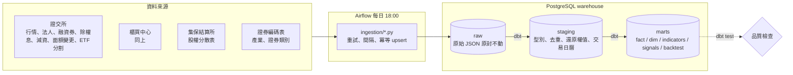

# 台股資料管線 tw-stock-pipeline

把證交所、櫃買中心、集保結算所的公開資料，每天自動抓進 PostgreSQL，用 dbt 清理成可分析的資料倉儲，再算出技術指標、K 線型態，並回測這些訊號到底有沒有用。

- **資料範圍**：上市＋上櫃約 2,470 檔，2023-10-19 起三年、約 730 個交易日，每天自動更新
- **資料量**：每日行情、三大法人、融資融券各約 150 萬列；技術指標、訊號各約 162 萬列
- **品質**：20 個 dbt model、141 個 dbt test，每天排程跑完一次 `dbt build` 約 2.5 分鐘，任何一個測試失敗整個 DAG 就失敗
- **回測結論**：三種經典 K 線型態都沒有統計上的優勢；只有「帶量突破 20 日高點、持有 20 天」有顯著超額報酬（[見下方](#回測結果)）

## 架構



整套環境用 `docker compose up -d` 一鍵啟動：一個 PostgreSQL（裡面兩個 database：Airflow metadata 與股票資料）加上 Airflow（LocalExecutor）。

## 資料模型

| 層 | 內容 | 重點 |
|---|---|---|
| raw | 每個來源一張表，一天（或一個月）一列，payload 是原始 JSON | 休市日也記一筆；parser 寫錯可以從 raw 重跑，不必再打交易所 |
| staging | `stg_daily_quotes`、`stg_institutional_trades`、`stg_margin_trades`、`stg_price_adjustments`、`stg_daily_quotes_adjusted`、`stg_trading_calendar` 等 | 上市、上櫃格式不同，在這層統一；除權息還原在這層做 |
| marts | `fact_daily_price`、`fact_institutional`、`fact_margin`、`fact_shareholding`、`dim_stock`（SCD Type 2）、`dim_date`、`indicators`、`signals`、`forward_returns`、`backtest_results` | 星狀模型；fact 用 as-of join 對到當天有效的 dim_stock 版本 |

## 技術選擇與理由

- **raw 原封不動存 JSON**：交易所的格式會變（例如櫃買中心 2010 年 15 欄、2026 年 17 欄），解析邏輯寫在 dbt，出錯時只要改 SQL 重跑，不用重新抓三年資料。
- **dbt 做轉換**：SQL 有版本控制、有相依關係圖、測試和 model 寫在一起；`dbt build` 一個指令就是「轉換＋品質檢查」。
- **incremental model**：三大法人、融資融券這類只會新增的資料用 delete+insert incremental，每天只處理新日期，約 1 秒；還原價會隨新的除權息事件改變過去的數字，所以行情、指標、訊號整張重建。
- **dim_stock 用 SCD Type 2**：股票會改名、轉市場（上櫃轉上市），用 gaps-and-islands 從每日行情推出每個版本的有效期間；surrogate key 用 `md5(代號 | 首次交易日)`，重建也不會變，incremental fact 才能安全引用。
- **門檻放在 `config/`**：K 線型態的實體比例、突破的量能倍數、回測的交易成本都是 CSV，dbt 當 seed 讀，調參數不用改 SQL。
- **Airflow 的日期來自 data interval**：要補某一天，在 UI 重跑那一次即可；raw 是 upsert、staging 是先刪後插，重跑不會重複。

## 遇過的資料問題與解法

這一段是這個專案花最多時間的地方。

### 除權息會造成假訊號，而且不只除權息

股價在除權息日會「跳」下去，不還原的話均線會斷崖、K 線型態會誤判。一開始只處理了除權息與減資，加上一個「漲跌幅不得超過 10%」的 dbt test 之後，抓到 81 筆違規，逐筆追查後發現三種還原錯誤：

| 問題 | 例子 | 解法 |
|---|---|---|
| **變更面額**沒有還原 | 綠界科技面額 10 元改 1 元，還原價一天跌 90% | 新增證交所 TWTB8U、櫃買 pvChgRslt 兩個來源 |
| **ETF 分割**沒有還原 | 0050 在 2025-06-18 一拆四 | 新增證交所 TWTCAU、櫃買 ETF 分割／反分割來源 |
| **現金增資除權**用錯參考價 | 天瀚除權當天其實是漲停 +9.9%，還原後卻變成 +62% | 改用「減除股利參考價」（交易所漲跌停的基準），不用含現增稀釋的「除權息參考價」 |
| 官方表**漏掉事件** | 華冠減資 80% 後恢復交易，四張官方表都沒有這筆 | 人工維護的 seed `manual_price_adjustments.csv`，每筆附出處 |

修完之後測試本身也要修正：沒成交的冷門股要比「連續兩個交易日」才適用 10%；現增除權當天交易所的漲跌停是**不對稱**的（漲停 = 減除股利參考價 × 1.1、跌停 = 除權息參考價 × 0.9）。最後 81 筆歸零。

### 上市、上櫃格式差很多

- 休市日：證交所回 `stat` 是一段中文錯誤訊息；櫃買中心回 `stat = "ok"` 但 data 是空的
- 無成交：證交所 `--`，櫃買中心有時 `----`、有時 `0.00`
- 漲跌符號：櫃買中心會出現 `- 0.19`、`除息` 這類字串
- 日期：`115年01月02日`、`115/01/12`、`1150112` 三種民國年寫法，用一個 macro 統一

### 交易日曆不能寫死

不假設週末休市（以前有補行上班的週六開盤），也不寫國定假日表；每天（含週末）都去抓，從回應推出開市或休市。這樣颱風假、臨時休市都會自動正確。2026-10-23（週五）兩個交易所都沒有資料，就是靠這個機制確認是休市而不是漏抓。

### 效能問題

- **相關子查詢**：incremental 的過濾條件寫成 `where f.market = outer.market` 的相關子查詢，資料量一大變成平方級，Airflow 的 dbt 卡了 17 分鐘；改成每個市場各自一個不相關的 `max(fetched_at)` 後約 1 秒。
- **Postgres 會把 CTE inline**：一個用 `jsonb_object_agg` 組欄位的 CTE 被每個 `->>` 重算一次；加 `as materialized` 強制只算一次。
- **排序溢出到磁碟**：dim_stock、indicators 要排序上百萬列，在 model 的 pre_hook 用 `set local work_mem` 調大（只影響該交易）；dim_stock 從 174 秒降到 7 秒。

### 其他

- 集保結算所會擋 python-requests 預設的 User-Agent（302 無限轉址），要帶瀏覽器 UA。
- 集保的股權分散表開放資料只有「最新一週」，沒有歷史，所以只能從開始抓的那週往後累積。
- 證券編碼表沒有歷史版本，所以舊的 dim_stock 版本只能帶目前的產業與證券類別。
- Windows 上的 dbt 用系統編碼（cp950）讀 `dbt_project.yml`，裡面不能有中文。

## 資料品質

`dbt build` 每天跑 141 個測試，除了 unique、not_null、relationships、accepted_values，還有這些自訂測試：

- 漲跌幅不超過 10%（含新上市、轉市場、現增除權的例外處理）
- 從回補起點到最新日期沒有缺漏的交易日
- 三大法人：外資＋投信＋自營商 = 合計
- 融資融券：前日餘額 + 買進 − 賣出 − 償還 = 今日餘額
- 股權分散表：各級距人數加總 = 總人數
- dim_stock 每檔的版本期間首尾相接、每筆行情只對到一個版本
- 最新一天的還原價 = 原始價
- 回測的買進價一定是「下一個交易日」的開盤價（防止 look-ahead bias）
- 每天每檔有成交的股票都有一筆訊號紀錄

## 回測結果

假設訊號日收盤後才知道訊號，**隔天開盤買進**，持有 5 或 20 個交易日後收盤賣出；只算個股（排除 ETF、債券），全部用還原價。超額報酬 = 訊號股報酬 − 同一天所有股票的平均報酬（扣掉大盤漲跌）。

| 訊號 | 持有天數 | 次數 | 平均報酬 | 勝率 | 平均超額報酬 | t 值 |
|---|---|---|---|---|---|---|
| 帶量突破 20 日高點 | 20 | 44,738 | +1.48% | 42.8% | **+0.74%** | **8.75** |
| 帶量突破 20 日高點 | 5 | 45,956 | −0.13% | 40.9% | −0.11% | −2.64 |
| 跌破 20 日低點 | 20 | 70,969 | +1.86% | 51.9% | −0.32% | −7.70 |
| 紅三兵 | 20 | 2,838 | +1.49% | 44.1% | +0.27% | 0.87 |
| 烏雲蓋頂 | 20 | 4,329 | +1.39% | 44.3% | +0.39% | 1.52 |
| 黃昏之星 | 20 | 1,049 | +0.49% | 44.6% | −0.22% | −0.51 |

基準（所有股票、所有日子）：持有 5 天平均 +0.10%，20 天 +1.13%。交易成本（手續費 0.1425% × 2 + 證交稅 0.3%）另計 0.585%。

- **只有帶量突破、持有 20 天有效**，扣成本後平均仍有 +0.89%；但中位數是負的、勝率只有 43%，是少數大漲的股票撐起平均。
- **三種 K 線型態都不顯著**（|t| < 2），和隨機挑一天差不多。
- **跌破 20 日低點是個陷阱**：原始報酬 +1.86% 比基準高，但這些股票集中在大盤重挫的日子，之後只是跟著大盤反彈；跟同一天的股票比，其實落後 0.32%。只看原始報酬會得到相反的結論。
- 限制：同一檔連續幾天出現訊號時持有期間重疊，t 值偏樂觀；這是驗證資料管線用的回測，不是實盤策略。

## 快速開始

```bash
cp .env.example .env          # 填入密碼與兩組 Airflow 金鑰（產生方式寫在檔案裡）
docker compose up -d          # PostgreSQL + Airflow，UI 在 http://localhost:8080

python -m venv .venv && .venv/bin/pip install -r requirements.txt   # Windows: .venv\Scripts\pip

# 第一次：回補歷史資料（每個請求間隔 5 秒，三年約需數小時；已抓過的日期會跳過，中斷可續跑）
python -m ingestion.backfill 20231019 20261022
python -m ingestion.corporate_actions 202310 202610
python -m ingestion.isin
python -m ingestion.shareholding

python scripts/run_dbt.py build   # 轉換＋測試（會讀 .env 的連線設定）
```

之後在 Airflow UI 打開 `tw_stock_daily`，每天台北時間 18:00 自動抓當天資料並跑 `dbt build`。電腦關機錯過的日子，用 `ingestion.backfill` 補回來即可。

## 專案結構

```
dags/            Airflow DAG（tw_stock_daily）
ingestion/       各資料來源的抓取程式，共用重試與寫入邏輯（common.py）
sql/raw/         raw 層建表 DDL
dbt/
  models/staging 清理、統一格式、還原權值、交易日曆
  models/marts   fact / dim / indicators / signals / backtest
  tests/         自訂資料品質測試
  seeds/         證券級距、人工補的還原事件
config/          門檻參數（K 線型態、回測成本），dbt 當 seed 讀
docker/          Airflow 自訂 image
scripts/         run_dbt.py：讀 .env 後執行 dbt
```

## 下一步

- Dashboard：今日訊號清單、個股 K 線與訊號標記、回測統計
- LINE bot：傳股票代號，回覆該股的趨勢與近期型態
